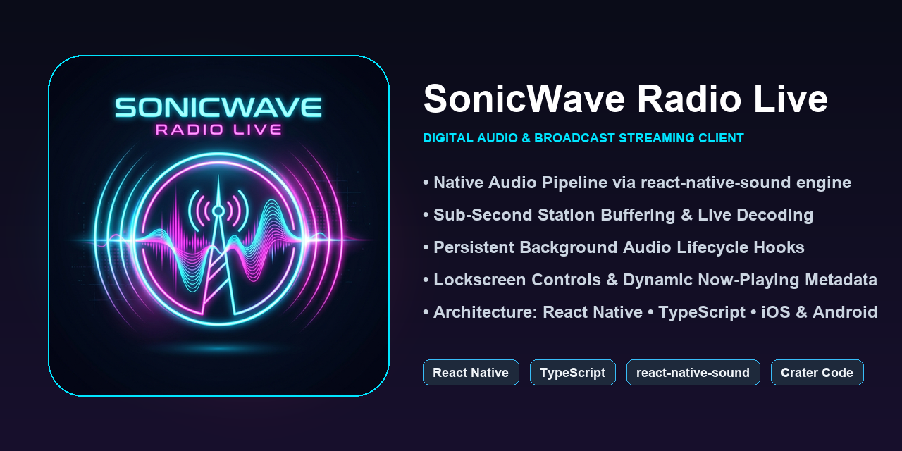
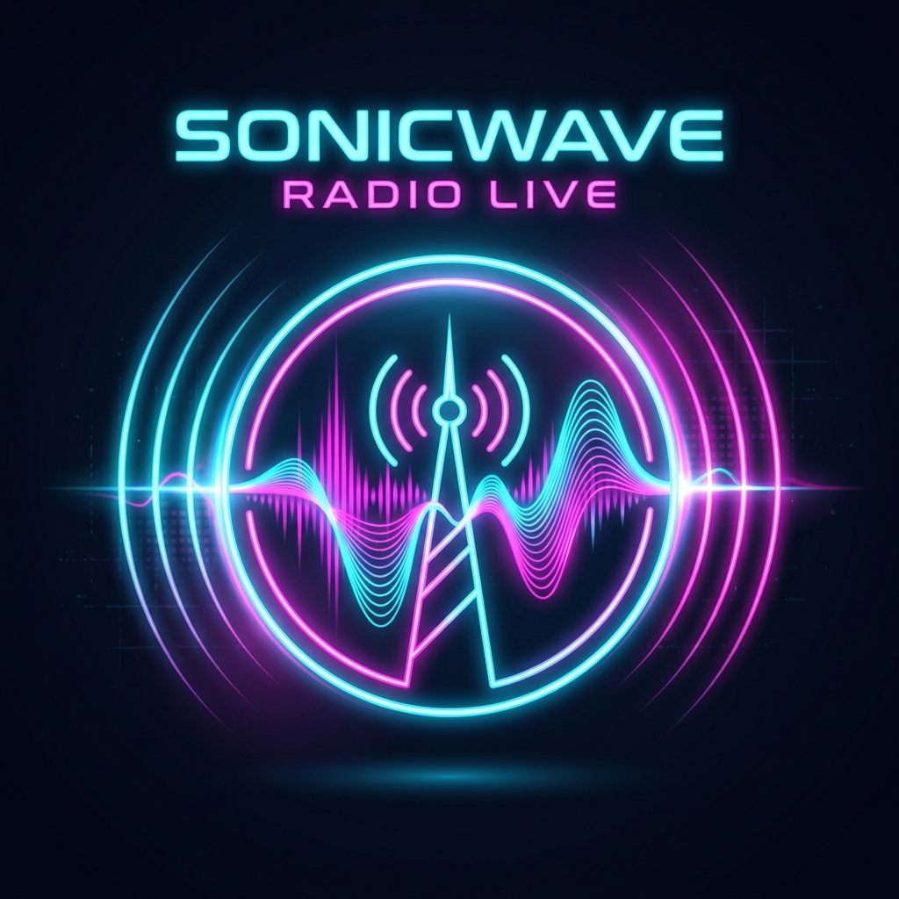
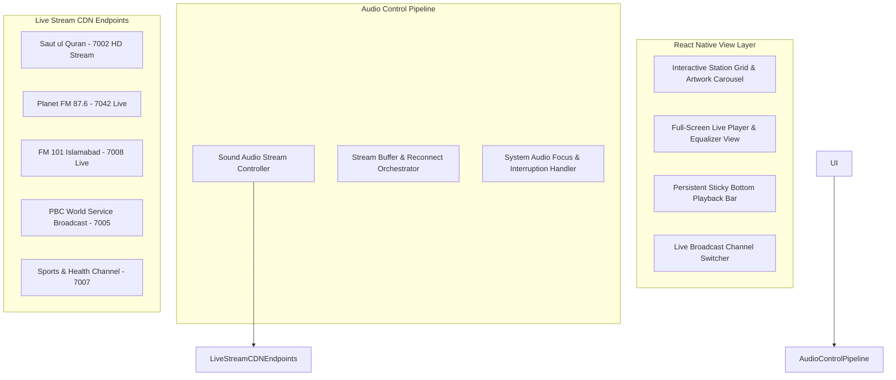

# 📻 SonicWave Radio Live

<p align="center">
  
</p>

<p align="center">
  
</p>

> **Cross-Platform Digital Audio & Live Radio Broadcast Streaming Mobile Application** built with **React Native and react-native-sound**, featuring sub-second live station streaming, dynamic station artwork, background playback lifecycle management, and station switching.

[](https://reactnative.dev)
[](https://www.typescriptlang.org)
[](https://github.com/zmxv/react-native-sound)
[](https://reactnative.dev)
[](LICENSE)

---

## 📌 Executive Summary

**SonicWave Radio Live** is a production mobile audio streaming client delivering national and regional live radio broadcasts across Pakistan and South Asia. Engineered with native audio driver hooks via `react-native-sound`, it provides low-latency HTTP/HTTPS live stream decoding, smooth buffer recovery, and continuous audio playback even through transient network fluctuations.

---

## 🏗️ System Architecture



---

## ✨ Core Features & Technical Highlights

### 1. 📡 Multi-Channel Live Broadcast Hub
- **Station Directory:** Includes official live streams for *Saut ul Quran*, *Planet FM 87.6*, *FM 101 Islamabad*, *Islamabad Central Station*, *Current Affairs Channel*, *PBC World Service*, and the *Sports & Health Network*.
- **Dynamic Stream Buffering:** Automatically handles network latency, connection handshakes, and jitter buffer stabilization.

### 2. 🎛️ Audio Lifecycle & Interruption Management
- Integrated `react-native-sound` state tracking managing stream initialization, playing, pausing, buffering, and resource disposal.
- Audio focus lifecycle handling to gracefully pause playback upon incoming phone calls or conflicting system audio events.

### 3. 🎨 Native-Feel User Interface
- Fluid navigation with `@react-navigation/native-stack`.
- High-resolution station artwork cards with real-time streaming state indicators.
- One-tap quick toggle between stations with seamless stream tear-down and handoff.

---

## 💻 Tech Stack & Dependencies

| Layer | Technologies |
| :--- | :--- |
| **Framework** | React Native 0.74 (Hermes JS Engine) |
| **Language** | JavaScript (ESNext) / TypeScript 5.0 |
| **Audio Engine** | `react-native-sound: ^0.11.2` |
| **Navigation** | `@react-navigation/native`, `@react-navigation/native-stack` |
| **Iconography** | `react-native-vector-icons (Ionicons)` |
| **Screen Safety** | `react-native-safe-area-context`, `react-native-screens` |

---

## 🚀 Getting Started

### Prerequisites
- Node.js (`>= 18`)
- Android Studio with Android SDK (API 34+) or Xcode (macOS)

### Setup Instructions
```bash
# Clone the repository
git clone https://github.com/itismemuhammadali/SonicWave-Radio-Live.git
cd SonicWave-Radio-Live

# Launch metro bundler
npx react-native start

# Run on target platform
npx react-native run-android   # Android Device / Emulator
npx react-native run-ios       # iOS Simulator
```

---

## 👤 Author

- **Muhammad Ali**
  - **GitHub:** [@itismemuhammadali](https://github.com/itismemuhammadali)
  - **Portfolio:** [Portfolio Platform](https://github.com/itismemuhammadali)
